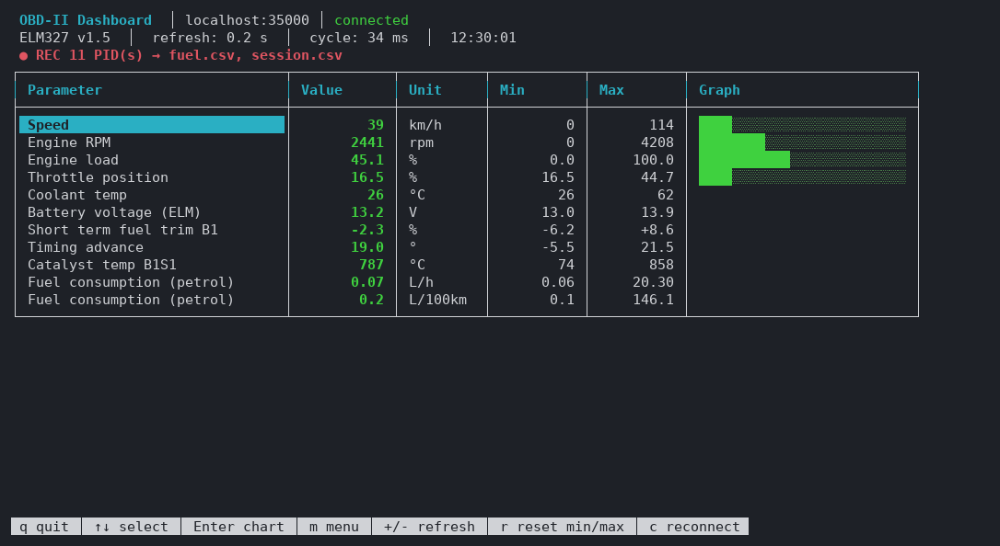
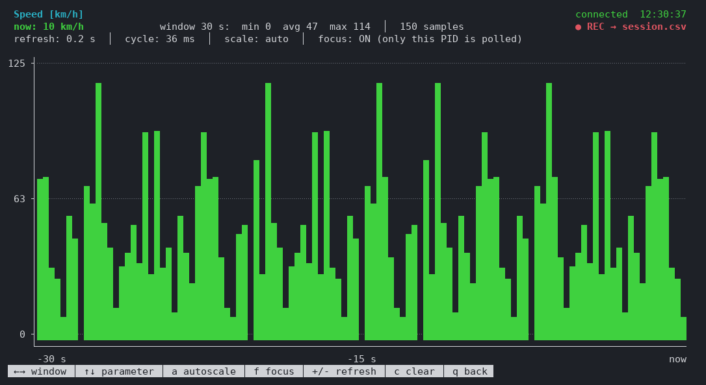
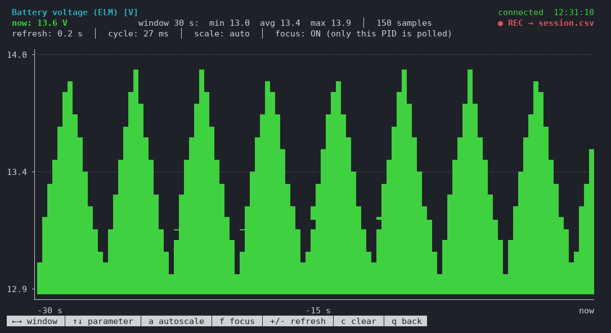
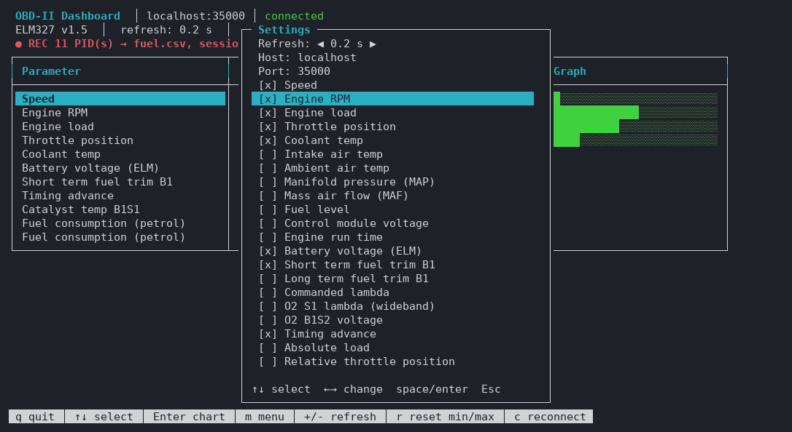

# OBD-II console dashboard

`obd-II-dashboard.py` is a terminal (curses) dashboard that talks to any ELM327 over TCP – ELM327-emulator (see [`../docker`](../docker) for a ready-made container) or a real WiFi ELM327 adapter: live values, min/max, live charts and CSV recording. Pure Python standard library, no dependencies.



## Requirements

- Python 3.8+ (tested with 3.14), standard library only.
- Linux or macOS terminal with UTF-8 (uses `curses`). Windows would need the `windows-curses` package (not tested).
- An ELM327 reachable over TCP – ELM327-emulator (e.g. the container from `../docker`), or a WiFi adapter (often `192.168.0.10:35000`).

## Usage

```bash
python3 obd-II-dashboard.py                                    # localhost:35000
python3 obd-II-dashboard.py --host 192.168.0.10 --port 35000   # WiFi ELM327
python3 obd-II-dashboard.py --interval 0.5                     # refresh every 0.5 s
python3 obd-II-dashboard.py --list-pids                        # list supported parameters
python3 obd-II-dashboard.py --record all=session.csv           # record everything to CSV
```

| Option | Default | Description |
|---|---|---|
| `--host` | `localhost` | ELM327 host |
| `--port` | `35000` | ELM327 TCP port |
| `--interval` | `1.0` | refresh interval in seconds (also `+`/`-` at runtime: 0.1 … 10 s) |
| `--record PIDS=FILE` | – | append samples to a CSV file; repeatable (see [Recording](#recording-to-csv)) |
| `--list-pids` | – | print PID codes, names and units, then exit |

On start the dashboard sends `ATZ`, `ATE0`, `ATL0`, `ATS0`, `ATH0`, `ATSP0` (reset, no echo, no spaces/headers, automatic protocol) and then polls the enabled PIDs (mode `01`) plus `ATRV` in a background thread. A lost connection is retried automatically every 2 s.

## Main screen


One row per enabled parameter: current value (green; yellow when stale, red on error), unit, min/max since start and a bar for parameters with a known range. The header shows the adapter version, refresh interval, the duration of one polling cycle and the recording status.

| Key | Action |
|---|---|
| `↑` `↓` | select parameter |
| `Enter` / `→` | open live chart of the selected parameter |
| `m` | settings menu |
| `+` / `-` | slower / faster refresh |
| `r` | reset min/max |
| `c` | reconnect |
| `q` | quit |

## Live chart





Full-screen bar chart with 1/8-character vertical resolution, axis labels, a time axis and min/avg/max for the visible window.

- The history is **cleared every time a chart is opened** (also when switching parameter with `↑`/`↓`), so each chart starts fresh.
- **Focus mode** is on while a chart is open: only the charted parameter is polled, which gives many more samples per second. Recorded PIDs are still polled so recordings have no gaps.
- **Autoscale** fits the Y axis to the visible data; fixed scale uses `0 … max` for parameters with a known range.

| Key | Action |
|---|---|
| `←` `→` / `[` `]` | time window: 10 s, 30 s, 1 min, 2 min, 5 min, 10 min |
| `↑` `↓` | previous / next parameter |
| `a` | autoscale on / off |
| `f` | focus mode on / off |
| `+` / `-` | refresh interval |
| `c` | clear history |
| `q` / `Esc` / `Backspace` | back to the main screen |

## Settings menu



`m` opens the menu: refresh interval (`←`/`→`), host, port, enable/disable parameters (`space`/`Enter`), reconnect and **Save settings**. Settings are stored in `~/.config/obd_dash.json` (also saved on exit):

```json
{
  "host": "localhost",
  "port": 35000,
  "interval": 1.0,
  "enabled": ["0D", "0C", "05", "04", "11", "RV"]
}
```

Command line options override the saved host, port and interval.

## Supported parameters

Default-enabled parameters are marked with ✓; the rest can be enabled in the menu.

| Code | Parameter | Unit | |
|---|---|---|---|
| `0D` | Speed | km/h | ✓ |
| `0C` | Engine RPM | rpm | ✓ |
| `04` | Engine load | % | ✓ |
| `11` | Throttle position | % | ✓ |
| `05` | Coolant temp | °C | ✓ |
| `RV` | Battery voltage (`ATRV`, measured by the adapter) | V | ✓ |
| `0F` | Intake air temp | °C | |
| `46` | Ambient air temp | °C | |
| `0B` | Manifold pressure (MAP) | kPa | |
| `10` | Mass air flow (MAF) | g/s | |
| `2F` | Fuel level | % | |
| `42` | Control module voltage | V | |
| `1F` | Engine run time | s | |
| `06` / `07` | Short / long term fuel trim, bank 1 | % | |
| `44` | Commanded lambda | λ | |
| `24` | O2 sensor 1 lambda (wideband) | λ | |
| `15` | O2 sensor B1S2 voltage (after the catalyst) | V | |
| `0E` | Timing advance | ° | |
| `43` | Absolute load | % | |
| `45` / `47` / `4C` | Relative throttle / absolute throttle B / commanded throttle actuator | % | |
| `3C` / `3E` | Catalyst temperature B1S1 / B1S2 | °C | |
| `33` | Barometric pressure | kPa | |
| `FH` | **Fuel consumption** (computed from MAF) | L/h | |
| `FK` | **Fuel consumption** (computed from MAF and speed) | L/100km | |

**Computed values.** `FH` and `FK` are not OBD PIDs; they are computed from other PIDs read in the same polling cycle (the source PIDs are polled automatically):

```
L/h     = MAF [g/s] * 3600 / (14.7 * 745)      # petrol: AFR 14.7, density 745 g/L
L/100km = L/h * 100 / speed [km/h]             # only above 3 km/h
```

The formulas assume a petrol engine at stoichiometric mixture; for diesel the results are too high.

## Recording to CSV

`--record PIDS=FILE` appends every new sample of the selected parameters to a CSV file while the dashboard runs. `PIDS` is a comma-separated list of codes (see `--list-pids`) or `all` (= every parameter enabled on the dashboard). The option can be repeated, and several parameters can share one file.

```bash
# one parameter -> one file
python3 obd-II-dashboard.py --record 0D=speed.csv

# several parameters -> one file, plus everything into another file
python3 obd-II-dashboard.py --record 0C,05=engine.csv --record all=~/obd/session.csv

# fuel consumption only, fast refresh
python3 obd-II-dashboard.py --interval 0.2 --record FH,FK=fuel.csv
```

While recording, the main screen shows `● REC n PID(s) → files` and a chart shows `● REC → file` when its parameter is recorded. On exit the dashboard prints what was written where.

**Format** – "long" CSV, one row per sample, UTF-8, header written only when the file is new:

```csv
timestamp,unix_time,pid,name,value,unit
2026-11-09T12:29:52.431+01:00,1794223792.431,0D,Speed,114,km/h
2026-11-09T12:29:52.433+01:00,1794223792.434,0C,Engine RPM,3787.5,rpm
2026-11-09T12:29:52.435+01:00,1794223792.436,04,Engine load,40.3922,%
```

| Column | Content |
|---|---|
| `timestamp` | ISO 8601 local time with milliseconds and UTC offset |
| `unix_time` | seconds since epoch (for calculations) |
| `pid` | parameter code |
| `name`, `unit` | human readable name and unit |
| `value` | numeric value (up to 6 significant digits) |

Every parameter keeps its own sample times, so nothing has to be interpolated and there are no empty cells. Each row is flushed immediately, so the file is complete even if the program is killed. Recorded parameters are always polled – also when they are not enabled on the dashboard and in chart focus mode.

The format imports directly into spreadsheets, databases and time-series tools. For example with pandas:

```python
import pandas as pd

df = pd.read_csv("session.csv", parse_dates=["timestamp"])
df["series"] = df["name"] + " [" + df["unit"] + "]"      # FH and FK share a name, units differ
wide = df.pivot_table(index="timestamp", columns="series", values="value")   # one column per parameter
wide.resample("1s").mean().plot(subplots=True)
```

## Notes about the emulated data

- In the `car` scenario most PIDs answer with values taken from a short fixed list (picked randomly or in sequence), so charts look like noise or repeat a pattern. This is the emulator, not the dashboard – a real car gives smooth curves.
- `ATRV` (battery voltage) is a smooth saw-tooth – a good PID to check that charts work.
- PID `A6` (odometer) answers with a malformed header (`61 A6 …` instead of `41 A6 …`) and `5B` (hybrid battery) returns `NO DATA`, so the dashboard does not use them.
